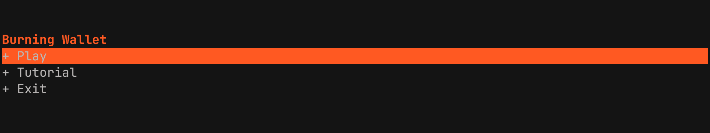

# Burning Wallet

A simple game about managing your money and reducing the burning rate of your wallet.



## Description

Burning Wallet is a terminal-based game built with React and Ink that challenges players to manage their finances wisely. The game simulates the constant struggle of balancing income and expenses while trying to reduce the rate at which your wallet "burns" through money.


## Features

- **Terminal-based interface** using React and Ink
- **Multiple game scenes**: Title screen, tutorial, gameplay, and game over
- **Financial management gameplay**
- **Interactive tutorial** to learn the basics

## Installation

1. Clone the repository:
```bash
git clone https://github.com/TemplateDev/burning-wallet-tui-game.git
cd burning-wallet-tui-game
```

2. Install dependencies:
```bash
npm install
```

## Usage

### Development
Run the game in development mode with hot reloading:
```bash
npm run dev
```

### Production
Build the project:
```bash
npm run build
```

Run the built version:
```bash
npm start
```

## Technologies Used

- **React** - UI framework
- **Ink** - React for CLIs
- **TypeScript** - Type safety
- **Node.js** - Runtime environment

## Game Controls

The game uses keyboard controls to navigate through different scenes and make financial decisions. Follow the on-screen instructions during gameplay.

## License

This project is licensed under the MIT License - see the [LICENSE](LICENSE) file for details.

## Author

TemplateDev

## Contributing

Contributions are welcome! Please feel free to submit a Pull Request.
